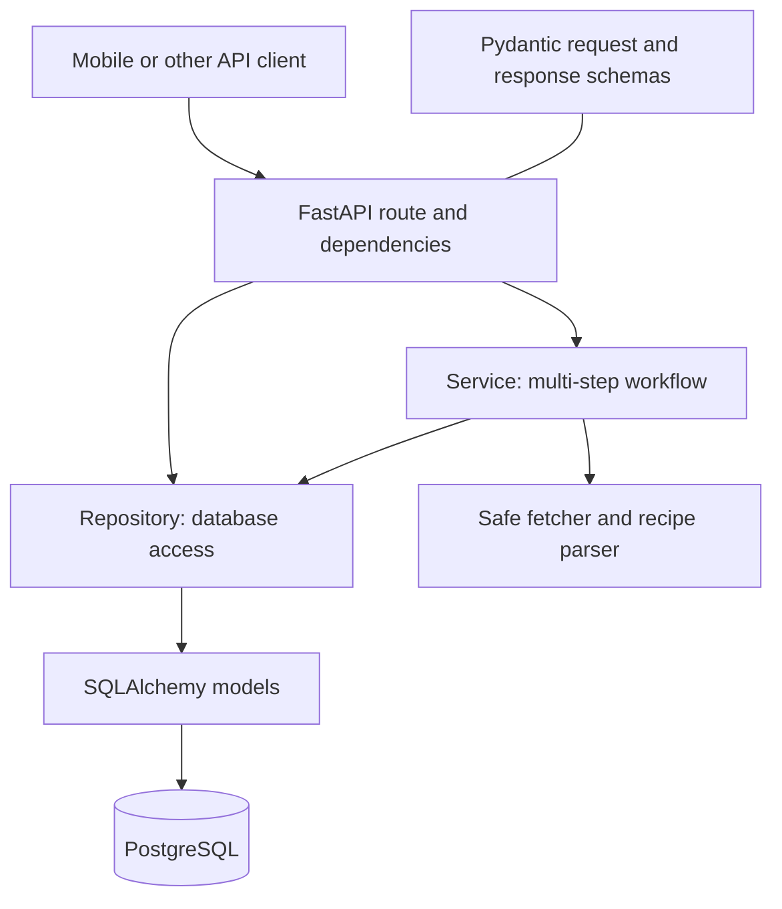
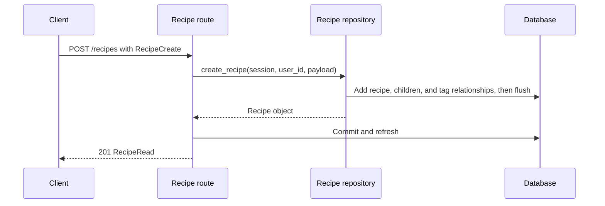
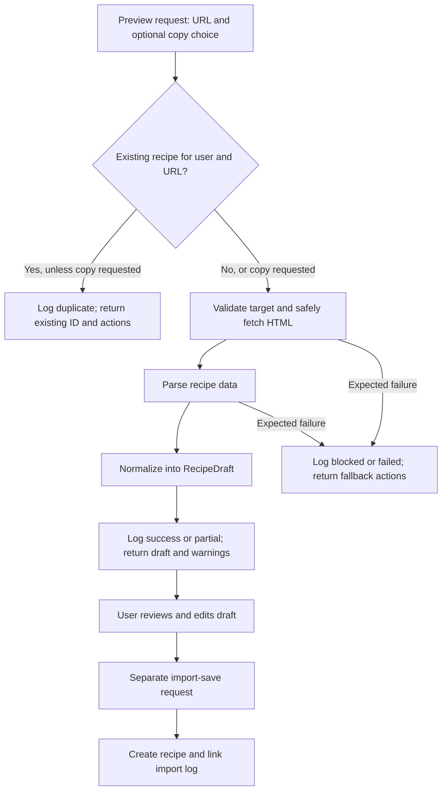

# Backend overview

Recipe Library's backend is a FastAPI application that stores user-owned recipes
and turns external recipe pages into editable drafts. PostgreSQL holds application
data, SQLAlchemy handles persistence, Pydantic defines API contracts, and Alembic
versions the database structure. The application is organized by responsibility
within one backend, rather than split into independently deployed services.

This document explains how the implementation fits together. For setup commands,
see [backend README](../backend/README.md); for individual endpoints and fields,
see [API reference](API.md) and [data model](DATA_MODEL.md).

## Application startup

The server loads `app` from [app/main.py](../backend/app/main.py).
`create_app()` reads cached settings from [core/config.py](../backend/app/core/config.py),
creates the FastAPI application, configures CORS, and registers the central API
router under `/api/v1`. Settings read environment variables and the backend `.env`
file; configuration includes the database URL, token settings, and allowed origins.

[api/router.py](../backend/app/api/router.py) connects feature routers for auth,
recipes, recipe notes, tags, imports, ingredient scaling, and health. Feature files
specify their own paths, so an import route declared as `/preview` becomes
`/api/v1/imports/preview` after both router prefixes are applied.

[core/database.py](../backend/app/core/database.py) constructs the SQLAlchemy engine
and session factory. Constructing the engine does not create the database schema:
Alembic migrations are a separate setup/deployment operation. Each request that
needs database access gets a session through `get_db`; its `finally` block closes
the session when dependency cleanup runs.

## Architecture and responsibility boundaries

**Routes** translate HTTP requests into application operations. They receive
validated inputs and dependencies, choose status codes, translate expected errors,
and commit or roll back writes. They do not implement page parsing or construct
complex recipe queries.

**Services** coordinate business workflows. For example, saving an import requires
checking its status, creating a recipe, and linking the import log. Those steps
belong together in a service. Simple recipe CRUD routes call repositories directly;
there is no extra service wrapper where it would only forward arguments.

**Repositories** construct queries and database objects. They receive a session
and explicit ownership information rather than reading HTTP headers themselves.
They may flush pending writes, but leave transaction completion to the caller.

**Schemas** and **models** serve different purposes. Pydantic schemas validate
incoming data and specify response fields. SQLAlchemy models represent tables,
relationships, and persisted values. A field can exist in the database without
being exposed through the API; `difficulty` is currently one such reserved field.

The main implementation directories are [routes](../backend/app/api/routes/),
[services](../backend/app/services/), [repositories](../backend/app/repositories/),
[schemas](../backend/app/schemas/), and [models](../backend/app/models/).

## How an authenticated request reaches application code

Consider `GET /api/v1/recipes/{recipe_id}`:

1. FastAPI matches the route and validates the path value as a UUID. For endpoints
   with request bodies, Pydantic also validates the body against the declared schema.
   Type hints alone are not the runtime validation mechanism.
2. Dependency resolution supplies the database session and current user before
   the handler runs. [get_current_user](../backend/app/api/dependencies.py) reads
   the bearer token, verifies/decodes it, converts its subject to a user ID, and
   loads that user. Invalid credentials or a missing user produce 401.
3. The route passes both `current_user.id` and `recipe_id` to the repository.
4. The repository queries for a recipe matching **both** IDs. Authentication tells
   us who is making the request; this ownership filter determines what they may
   access. A missing recipe and another user's recipe both become a 404 response.
5. The route returns the SQLAlchemy recipe. Its `RecipeRead` response model
   converts the exposed fields and relationships to the API representation.

FastAPI handles dependency resolution and validation; these are prerequisites to
calling the handler, not a manually coded sequence inside it. The same `get_db`
dependency is reused within a request through FastAPI's dependency caching.

Login follows a different entry path: [auth routes](../backend/app/api/routes/auth.py)
call the authentication service to verify credentials, then issue a signed access
token. Subsequent protected requests use that token. Logout currently acknowledges
the request and relies on the client to discard its token; it does not revoke an
already-issued token on the server.

## Recipe creation, reading, and editing

### Creating a manual recipe

In [recipe_repository.create_recipe](../backend/app/repositories/recipe_repository.py),
scalar fields such as title and description populate the recipe itself. Ingredients,
steps, and tips become related records rather than a single opaque JSON blob.
Tags are resolved by name within the current user's tags; missing names create new
tag objects. The repository flushes the assembled records and returns the recipe.

The [recipe route](../backend/app/api/routes/recipes.py) commits and refreshes it.
Pydantic's response schema exposes the saved representation, including the assigned
ID. The caller can use that response without guessing what the database stored.

### Reading and searching

Detail queries load ingredients, steps, tips, and tags with `selectinload` so the
response can access those relationships. List queries always start with the owner
filter, then add requested title, ingredient, tag, favorite, or time conditions and
sorting. Search is currently implemented with SQL queries, not a separate search
index. List and detail responses use different schemas because library cards do
not need the entire recipe.

### Updating an existing recipe

`PATCH /recipes/{recipe_id}` validates a `RecipeUpdate` payload and performs the
same owner-scoped lookup. The repository uses `exclude_unset=True` for scalar
fields and `model_fields_set` for collections. This preserves the distinction
between omitting a field and intentionally changing it.

For example, omitting `description` preserves its stored value; supplying null
clears it where allowed by the schema. Omitting `steps` leaves the saved steps
alone; supplying `steps: []` removes them. When a collection is supplied, its
contents replace the existing relationship rather than patching individual child
IDs. See [recipe schemas](../backend/app/schemas/recipe.py) for field-specific
validation and null rules.

## Importing is a preview workflow followed by a separate save

Fetching an external page is unreliable and its contents need user review. The
backend therefore separates obtaining a draft from creating a saved recipe.

### Duplicate detection and orchestration

The [preview route](../backend/app/api/routes/imports.py) receives a
`RecipeImportPreviewRequest` and calls
[preview_recipe_import](../backend/app/services/import_preview.py). Before network
access, that service checks for a saved recipe with the submitted source URL and
current owner. A duplicate produces an import log, an existing recipe ID, and
`open_existing`/`import_as_copy` actions, with no draft.

An explicit `import_as_copy: true` bypasses that lookup and requests a fresh page
preview. It does not clone the stored recipe or save anything automatically.

### Safe fetching, parsing, and normalization

[RecipeImporter](../backend/app/services/recipe_importer.py) coordinates three
separate jobs:

1. **Fetch:** [safe_fetcher.py](../backend/app/services/safe_fetcher.py) validates
   HTTP/HTTPS targets, resolves host addresses, rejects non-global addresses,
   checks redirects, limits HTML response size, and applies content-type rules.
   [safe_transport.py](../backend/app/services/safe_transport.py) connects using
   validated addresses with connection/read timeouts. Pinning validated addresses
   prevents a later DNS lookup from silently changing the destination.
2. **Parse:** [recipe_parser.py](../backend/app/services/recipe_parser.py) extracts
   recipe information from the already-fetched HTML using `recipe-scrapers`.
   Keeping fetching outside the parser makes network policy enforceable in one path.
3. **Normalize:** [recipe_normalizer.py](../backend/app/services/recipe_normalizer.py)
   converts parser output into `RecipeDraft`, assigns ingredient/step positions,
   interprets supported yield text, and collects warnings. Ingredients retain their
   text and currently default to unparsed structured fields.

A normalized draft missing ingredients or steps is classified as `partial`;
otherwise it is `success`. Other missing optional information can produce warnings
without necessarily changing that status.

### Expected failures are preview results

Unsafe targets become blocked-import errors; fetch or parse failures become
failed-import errors. The preview service catches these expected importer errors,
records a log, and returns a structured `blocked` or `failed` response with no
draft and with manual-entry/source-link actions. These are preview outcomes, not
successful recipe saves and not necessarily HTTP request failures.

Unexpected exceptions still propagate, and the route rolls back its transaction.
This distinction lets clients show useful fallback choices for unsupported sites
while treating authentication, validation, or infrastructure errors separately.

### Saving the reviewed draft

`POST /imports/{import_id}/save` accepts the same backend `RecipeCreate` schema as
manual creation, but calls
[save_reviewed_import](../backend/app/services/import_save.py). That service:

1. Loads the import log scoped to the current user.
2. Requires a saveable status (`success` or `partial`) and no existing recipe link.
3. Builds a trusted payload by replacing submitted source URL/domain with values
   from the import log.
4. Reuses recipe creation with the imported origin, then links the recipe to the log.

The route commits both writes together and returns the saved recipe. A nonexistent
or other-user import returns 404; an unsaveable or already-linked import returns
409. The client can edit recipe contents, but cannot use that edit to substitute
untrusted source URL/domain values for the saved import.

The log persists import outcome and provenance; it is not a complete version
history or a permanent original-draft snapshot. The draft returned to the client
is reviewed there and submitted back for saving. Full webpage HTML is not stored
by default. More details are in [import pipeline](IMPORT_PIPELINE.md).

## Data lifetime and persistence

| Data | Where it lives | Lifetime |
| --- | --- | --- |
| Users, password hashes, recipes, ingredients, steps, tips, notes, and tags | PostgreSQL records and relationships | Persist after a successful commit, across requests and application restarts. |
| Import outcome, source attribution, warnings, and recipe link | Import log in PostgreSQL | Persist after the preview/save transaction commits. A log is not a saved recipe or a full draft snapshot. |
| Fetched HTML and intermediate parser/normalizer objects | Memory during preview processing | Used to produce the response, not persisted as complete pages by the current workflow. |
| SQLAlchemy session and tracked objects | Request-scoped backend memory | Closed after the request. Uncommitted work is not durable application data. |
| Reviewed draft sent to the client | Response JSON, then client state | Does not become a recipe until a separate save request succeeds. |

The current preview workflow does not provide server-side recovery of unsaved
draft edits. An import ID identifies the log and save workflow, not a stored editor
session. Likewise, changing a saved ingredient's text does not create a permanent
history of prior wording. Source attribution allows revisiting the original site,
but cannot guarantee the page remains available or unchanged.

## Transactions and error boundaries

A SQLAlchemy session tracks objects and pending writes. **Flush** sends those
writes to the database within the current transaction; **commit** completes the
transaction. A flushed recipe is not yet a successfully committed recipe.

Write routes own commit/rollback. Repositories and import services avoid committing
so multiple operations can form one atomic unit. If linking an import fails after
creating its recipe, rollback prevents a partly completed save. Closing the session
in `get_db` is resource cleanup, not a substitute for explicitly completing the
transaction.

| Failure | Boundary that handles it | Client result |
| --- | --- | --- |
| Invalid request shape/value | FastAPI/Pydantic | 422 validation response |
| Invalid bearer credentials | Authentication dependency | 401 |
| Missing or other-user recipe/import | Route after scoped lookup/service error | 404 |
| Unsaveable/already-saved import | Import service exception mapped by route | 409 |
| Expected fetch/parse failure | Importer and preview service | Logged blocked/failed preview with fallback actions |
| Unexpected write failure | Route rollback and re-raise | Request fails; writes are not committed |

## Testing the architecture

Tests follow the same boundaries. Pure service tests check parsing, normalization,
and scaling without HTTP. Repository tests exercise queries and relationships.
Endpoint tests exercise validation, authentication, ownership, status codes, and
transaction behavior through FastAPI's test client.

[tests/conftest.py](../backend/tests/conftest.py) creates isolated in-memory SQLite
databases and overrides `get_db` on a fresh app. It also provides test users and
signed authorization headers. This keeps tests independent of a developer's
PostgreSQL data. SQLite tests do not prove every PostgreSQL-specific behavior;
production schema changes still go through Alembic and PostgreSQL verification.

The importer accepts injected fetcher, parser, and normalizer dependencies. Tests
can supply deterministic HTML/results or raise failures without contacting live
recipe websites. Safe-fetch tests exercise network policy with controlled
resolvers/requesters; endpoint tests can replace the importer dependency.

Useful examples are [recipe repository tests](../backend/tests/test_recipe_repository.py),
[importer tests](../backend/tests/test_recipe_importer.py),
[import-save service tests](../backend/tests/test_import_save_service.py), and
[import-save endpoint tests](../backend/tests/test_import_save_endpoint.py).
Check commands and local API documentation are in the [backend README](../backend/README.md).

## Where a change belongs

A new field may require a schema change, a model/migration if persisted, repository
handling, and response coverage. A new filter belongs in query construction plus
route/query validation. A rule coordinating several writes belongs in a service,
with the route retaining the transaction boundary. Website extraction issues
belong in parsing/normalization; network restrictions belong in safe fetching and
transport rather than individual routes.

## Known limitations and planned boundaries

- Structured ingredient parsing and integration with cooking-view scaling remain
  follow-up work. The leading-quantity scaler is not a complete ingredient parser.
- Authentication issues expiring access tokens without a refresh-token workflow.
  Logout does not revoke an issued token, so client deletion is not server revocation.
- Import previews depend on external page accessibility and supported recipe data.
  A blocked/failed result is an expected product outcome, not a reason to bypass
  website restrictions.
- Import rate limits and other public-deployment safeguards remain tracked work.
  Safe-fetch protections do not imply every deployment control is implemented.
- Unsaved draft recovery, original-draft snapshots, and recipe version history are
  not provided by the current import log.

See [security](SECURITY.md), [app considerations](APP_CONSIDERATIONS.md), and
[roadmap](ROADMAP.md) for requirements and follow-up scope rather than treating
this list as a separate implementation backlog.
