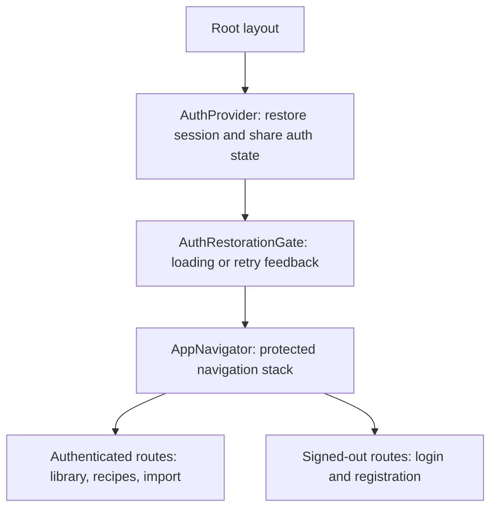
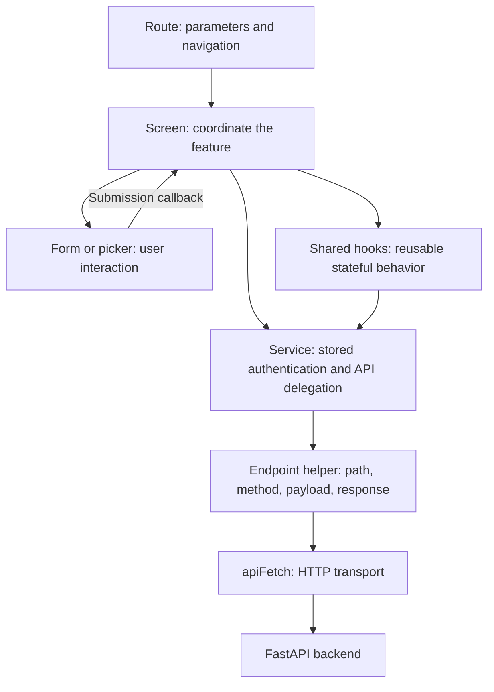
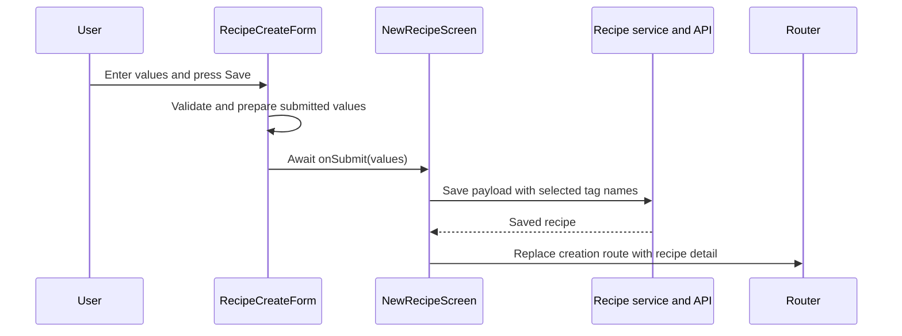

# Mobile overview

The current frontend is a React Native application built with Expo, TypeScript,
and Expo Router. It provides authentication, a searchable recipe library, manual
creation and editing, recipe detail, and URL import previews. This document traces
how those features work and where their responsibilities live. A separate desktop
frontend remains future work.

See [mobile setup and commands](../mobile/README.md) to run the app and
[backend overview](BACKEND_OVERVIEW.md) for the other side of its API calls.

## Application startup and navigation

[package.json](../mobile/package.json) uses `expo-router/entry`. Expo Router maps
files in `mobile/app/` to routes and loads
[app/_layout.tsx](../mobile/app/_layout.tsx) as the root layout. That layout nests
three components:



[AuthProvider](../mobile/src/auth/auth-provider.tsx) begins in a loading state and
calls `restoreSession`. [AuthRestorationGate](../mobile/src/auth/auth-restoration-gate.tsx)
handles restoration feedback before normal navigation is shown.
[AppNavigator](../mobile/src/auth/app-navigator.tsx) uses protected stack groups
based on authentication state. Client-side route protection controls the UI;
the backend still authenticates requests and checks ownership independently.

Route files are the navigation boundary. For example,
[the detail route](../mobile/app/recipes/[id].tsx) reads the recipe ID and focus
state, then passes them and an edit callback to `RecipeDetailScreen`. The screen
can render and be tested without owning an Expo router. This separation is not
uniform everywhere: the library and creation route files still contain their
screen orchestration directly.

## How the layers cooperate



A screen combines loading, a form, and related operations. Forms keep editable
values and validation close to the inputs. Shared hooks encapsulate reusable
behavior, such as loading tags or maintaining stable row identities. Services
retrieve the stored token; endpoint helpers accept that token explicitly and
make a particular request. `apiFetch` supplies common HTTP behavior.

This is a division of responsibilities rather than a requirement that every
operation pass through every layer. Session restoration has its own orchestration,
and the development health button calls `apiFetch` directly.

## Authentication and session restoration

[session.ts](../mobile/src/auth/session.ts) coordinates API calls and
[token-storage.ts](../mobile/src/auth/token-storage.ts), which wraps Expo SecureStore.
On sign-in, it requests a token, loads the current user with that token, and saves
the token before returning the user. The provider then dispatches an authenticated
state transition. Failed sign-in is shown by the authentication UI.

Restoration reads the saved token. No token means signed out. A valid token loads
the current user. If that request returns 401, restoration removes the invalid
token and returns signed out. Other failures propagate so a temporary connection
problem can show restoration retry feedback instead of silently discarding the
session. Signing out removes the local token; it does not revoke it on the backend.

The provider's restoration effect uses an `active` flag to ignore results after
cleanup. This prevents an obsolete request from updating state. It does not abort
the network request itself. Retrying changes an attempt counter to run restoration
again. [auth-state.ts](../mobile/src/auth/auth-state.ts) defines the reducer's state
transitions rather than spreading authentication booleans across screens.

## From a screen to the API and back

For a recipe detail request, the screen calls `loadRecipe(recipeId)` in
[recipe-service.ts](../mobile/src/recipes/recipe-service.ts). The service retrieves
the token and rejects missing credentials before calling the recipe API helper.
[api/recipes.ts](../mobile/src/api/recipes.ts) builds the endpoint and authorization
header; [api/client.ts](../mobile/src/api/client.ts) performs `fetch`.

The client reads `EXPO_PUBLIC_API_BASE_URL`, falling back to the local development
API URL. It supplies a JSON content type when absent, throws `ApiError` for
non-success HTTP statuses, returns `undefined` for 204, and otherwise decodes JSON.
An endpoint expecting a recipe rejects `undefined` rather than returning a missing
recipe as success. Network errors propagate naturally.

TypeScript types in [src/types](../mobile/src/types/) describe the expected
contracts, including the backend's snake_case fields. The generic argument to
`apiFetch` is not runtime JSON validation. Also, `ApiError` currently carries the
HTTP status rather than decoding every backend error detail. UI code selects safe
feedback for the operation instead of displaying arbitrary internal errors.

## Loading and searching the library

[app/index.tsx](../mobile/app/index.tsx) owns search input, submitted query, filters,
sort order, loading state, and results. Search text and submitted query are separate:
typing does not request a new list until Search is pressed. The submitted value is
trimmed without changing what the user is typing.

A focus effect loads recipes when the library becomes active or its query/filter
inputs change. It sends those options through `loadRecipes`, then renders summary
cards in a `FlatList`. Filtering and sorting are requested from the backend rather
than performed over only the currently displayed records. Empty-library,
no-matching-results, and request-error states have different feedback.

The effect ignores stale responses after cleanup. Returning to the library
triggers another load, which picks up saved changes. Recipe server state is held
locally by the relevant screens; the application does not currently rely on a
shared query cache to synchronize every view.

## Creating a recipe



[RecipeCreateForm](../mobile/src/recipes/recipe-create-form.tsx) stores text input
as text and validates/prepares values at submission. Trimming on every keystroke
would prevent ordinary spaces while typing. Numeric conversion must distinguish
blank input from zero, and optional blank creation fields can be omitted.

[NewRecipeScreen](../mobile/app/recipes/new/index.tsx) owns tag selections and
combines the submitted form values with selected tag names. The service returns
the saved recipe, whose ID determines the detail destination. Replacing the create
route prevents Back from reopening a completed creation form.

The form handles submission errors and preserves entered values for retry. A
screen-level saving flag also disables tag interactions, while the form's own
pending state disables its fields and row controls. Tag creation is a separate
operation: it can block recipe submission without preventing unrelated field
editing. This distinction avoids treating all kinds of pending work as identical.

## Editing and returning to detail

[RecipeEditScreen](../mobile/src/recipes/recipe-edit-screen.tsx) loads the saved
recipe and coordinates tag loading. Once loaded, it supplies initial values to
[RecipeEditForm](../mobile/src/recipes/recipe-edit-form.tsx). The form initializes
local draft state from those values; props are not continuously copied into state,
which would overwrite in-progress edits during rerenders.

The form validates and awaits the submission callback. The screen composes the
update payload and calls `saveRecipeChanges`. Errors propagate back to the form's
save feedback. Loading errors belong to the screen because they occur before an
editable recipe exists. Keeping those boundaries separate preserves the draft
through a failed save or a tag-loading retry. Tag retry is disabled during saving,
and its handler also guards against saving or an existing tag load. After a failed
save, retry becomes available again without resetting recipe edits.

An omitted update field means leave the saved value unchanged. Null clears an
allowed scalar, and an explicit empty collection clears that collection. In
particular, unavailable tag selections must not be mistaken for an intentional
empty selection.

[The edit route](../mobile/app/recipes/[id]/edit.tsx) handles successful saves with
`router.dismissTo` for the saved recipe's detail route. This returns to an existing
detail entry when present, avoiding an extra stale detail screen on the stack.
The detail route passes its focus state into
[RecipeDetailScreen](../mobile/src/recipes/recipe-detail-screen.tsx), which reloads
when focused again. Navigation fixes the stack, and focus-driven loading refreshes
the displayed data; they solve different parts of the return flow.

## Shared hooks and derived state

[useAvailableTags](../mobile/src/tags/use-available-tags.ts) owns available tags,
loading/error state, retry, and adding newly created tags to the local list.
[useTagCreation](../mobile/src/tags/use-tag-creation.ts) owns creation eligibility,
pending state, and creation errors. Its success callback lets each screen decide
how to append/select the returned tag. Creating a tag persists that tag separately;
it does not attach it to a recipe until the recipe submission includes it.

[SearchableTagPicker](../mobile/src/tags/searchable-tag-picker.tsx) receives
controlled search and selections. Matching tags are derived from available tags
and the search term, rather than stored as another state array. Filtering happens
before the result limit. The parent retains the search text because creation also
uses it; the picker handles selection/removal UI.

[useFormTextRows](../mobile/src/recipes/use-form-text-rows.ts) manages text rows
with stable local IDs, including add/remove/update operations. A ref advances IDs
without reusing them after deletion. These IDs identify React rows; submitted
positions are computed separately after blank rows are filtered. Reindexing IDs
on removal could make React associate an input with the wrong row.

Ingredient editing also retains saved ingredient metadata per row.
[formatEditedIngredients](../mobile/src/recipes/format-edited-ingredients.ts)
preserves parsed fields when the trimmed text is unchanged, resets parsing fields
when it changes, and retains existing optional/scaling-lock flags. New rows start
with defaults. Keeping the original saved metadata in draft state allows reverting
text to recover its original parsed values.

## URL import previews and fallback actions

[The import route](../mobile/app/import.tsx) supplies navigation callbacks and
header height to [ImportRecipeScreen](../mobile/src/imports/import-recipe-screen.tsx).
[ImportUrlForm](../mobile/src/imports/import-url-form.tsx) owns URL input,
HTTP/HTTPS validation, submission pending state, and request-error feedback.
The screen owns the returned preview and the URL used to obtain it.

Submitting a URL clears the old result and requests a preview through the import
service. Success/partial results display draft content; duplicate/blocked/failed
results show outcome feedback. Offered actions come from `next_actions`, not from
an assumption that a particular status always permits an action. Warnings that
repeat the status message are filtered while other warnings remain visible.

Opening an existing recipe or manual creation uses push navigation, preserving
the import screen for Back. Opening the source uses the submitted URL, even if
the input was subsequently edited. Link-opening errors have their own retry
feedback because opening a browser is separate from requesting a preview.

Import as copy requests a new preview with `import_as_copy: true`. It uses the
URL associated with the displayed duplicate result. While pending, the form and
fallback controls disable. A thrown request error preserves the duplicate result;
a returned result replaces it. This operation does not save a recipe.

[formatImportDraft](../mobile/src/imports/format-import-draft.ts) prepares a save
payload from reviewed form values and the original draft. Editable fields come
from the reviewed values, including intentional clearing; source metadata and
tags are retained from the draft. Nullable scalar values become omitted create
fields rather than restoring old draft values. Reviewed ingredient/step metadata
passes through unchanged. Named creation-row types require core text/position
fields while allowing optional metadata, supporting both manual and imported rows.
Success and partial previews now render RecipeEditForm on the import screen,
prefilled with the draft. The adapter prepares its reviewed values for saving.

[saveRecipeImport](../mobile/src/api/imports.ts) and
[saveImportDraft](../mobile/src/imports/import-service.ts) now provide the API and
stored-token service for saving reviewed imports. The screen saves against the
current preview's import ID and passes only the saved recipe ID to its onSaved
callback. The route replaces the import editor with recipe detail, so Back returns
to the library rather than a completed editor. Library focus reloads saved data.

The form retains its local inputs and displays import-specific feedback after a
save failure. Screen-level saving state disables the URL form and fallback actions;
form submission state disables recipe inputs and row controls. A finally block
restores screen controls while errors propagate to the form. RecipeEditForm accepts
optional save-label/error-message props, retaining defaults for existing recipe edits.
The screen also uses useAvailableTags and SearchableTagPicker for existing-tag
selection. Draft names initialize selected IDs only after loading and complete
matching succeed. A null selection means uninitialized; an empty array means the
user intentionally cleared all tags. Ready selections replace the adapter's draft
tags with selected names before saving. Loading or matching failures preserve the
original draft tags and offer a local retry without remounting the recipe form.
Tag controls and retry disable while saving; failed saves retain selections and
search text. New previews reset tag state.

Inline creation reuses useTagCreation for name validation, authenticated creation,
and safe error feedback. The screen adds the returned tag to the available list
and selects its ID; selection clears search. Creation persists the tag independently
of saving the recipe. While creation is pending, the screen blocks tag interactions,
recipe saving, and competing preview actions, but recipe fields remain editable.
Blocking replacement previews prevents a late creation result from selecting a tag
in a different draft. Creation failures retain edits and selections; changing search
or starting a new preview clears old request feedback.

The separate [import-preview route file](../mobile/app/import-preview.tsx) remains
a placeholder; the working editor lives on the existing import screen.

## Data lifetime and persistence

| Data | Where it lives | What survives |
| --- | --- | --- |
| Access token | Expo SecureStore | Normal app restarts, until removed or invalidated by the restoration flow. A stored token can still expire. |
| Current user and authentication status | AuthProvider memory | Provider lifetime. Restarting reconstructs this state using the stored token and the backend. |
| Loaded recipes and available tags | Screen/hook state | Component lifetime. These are fetched copies of backend records, not a persistent offline database. |
| Unsaved form inputs, selections, and errors | Form/screen state | Rerenders and failed submissions while the component remains mounted. Unmounting or restarting loses them. |
| Import URL and preview | Import screen/form state | Back from a pushed fallback route while that screen remains mounted. Removing the route or restarting loses the preview. |
| Saved recipes and newly created tags | Backend database | Successful saves survive app restarts and can be fetched again. Creating a tag persists it even if the recipe form is later abandoned. |

Navigating away is not always the same as unmounting: a pushed screen can leave
the previous screen on the stack with its state intact. Replacement, dismissal,
or other removal can end that component's lifetime. The app does not currently
persist unfinished forms, import previews, or queued writes for offline recovery.
An import log on the backend does not restore the local preview or user edits.

## Mobile layout and asynchronous feedback

Scrollable forms use safe-area handling and keyboard avoidance so bottom controls
remain reachable. Routes that know the navigation header height supply it to the
screen where appropriate. Native `TextInput`, `Button`, and other controls carry
accessible labels used both by assistive technology and interaction tests.

Pending states disable controls and guard handlers. `try/finally` restores state
on both success and failure. Effect cleanup flags ignore obsolete responses,
while validation, loading, saving, tag creation, and external-link errors remain
attached to their respective operations. A recipe can load successfully even if
its remote image fails, so image failure must not replace recipe-load feedback.

## Testing and verification

Jest uses the Expo preset, with React Native Testing Library for user interactions.
[API tests](../mobile/src/api/__tests__/) verify requests and response/error handling;
service tests mock token storage and endpoint helpers. Form and screen tests check
validation, displayed feedback, pending controls, and retained values.

[Navigation tests](../mobile/src/auth/__tests__/app-navigator.test.tsx) exercise
routes and Back behavior. Controlled unresolved promises expose the pending state
before resolving or rejecting, avoiding arbitrary delays. Shared
[recipe fixtures](../mobile/src/test/fixtures/recipes.ts) build typed responses with
small overrides for each scenario. TypeScript checks catch contract mismatches
that passing interaction tests alone may miss.

From `mobile/`:

```sh
npm test -- --runInBand
npx tsc --noEmit
```

Android verification complements automated tests for keyboard overlap, native
navigation, browser links, layout, and actual device connectivity. A helper-only
API change does not require inventing a UI verification flow. Setup and backend
connection instructions are in [mobile README](../mobile/README.md).

## Where a change belongs

Navigation destinations and route parameters belong at the route boundary. Input
validation and draft preservation belong in forms. Coordinating recipe data with
tags belongs in screens. Repeated stateful behavior can move to a hook when its
responsibility is clear. Token access belongs in services, endpoint serialization
in API helpers, and cross-endpoint HTTP behavior in `apiFetch`.

Use explicit `import type` for type-only dependencies. Imports are grouped as
packages, `@/` aliases, and relative imports, with full lines sorted ascending
within each group. The alias maps `@/*` to `src/*` in
[tsconfig.json](../mobile/tsconfig.json).

## Personal notes

[listNotes](../mobile/src/api/notes.ts) fetches `/recipes/{recipeId}/notes` using a
supplied bearer token. The response is a plain array of `id`/`note` objects; an
empty array is valid, while a missing response is rejected.
[loadNotes](../mobile/src/notes/note-service.ts) retrieves stored credentials and
forwards the recipe ID. Storage and request failures propagate without becoming
empty results. The backend enforces recipe ownership. Personal notes are separate from recipe tips.

[RecipeNotesSection](../mobile/src/notes/recipe-notes-section.tsx) loads notes in
local component state and renders them after Source tips on recipe detail. Its
loading, empty, and error/retry states are independent of recipe loading, so a notes
failure leaves the recipe readable and retry requests only notes. An active flag
ignores stale success, failure, and completion updates after cleanup.

The detail screen unmounts the section while unfocused and clears its loaded recipe
on blur. On return it refreshes the recipe before mounting notes, avoiding a notes
request against the old render followed by another on remount. The parent owns
focus handling through conditional mounting; the notes section loads on mount or
recipe change and invalidates pending results on cleanup. Notes are fetched again on return;
there is no persistent notes cache. Adding, editing, and deleting notes in the
mobile UI remain future work.

## Known limitations and planned boundaries

- There is no shared server-state query cache. Screens reload through their own
  effects/focus behavior, so a successful write does not automatically update
  every mounted screen's copy of a recipe.
- There is no automatic token refresh or general request replay after token
  expiry. Session restoration handles 401 explicitly; other request failures
  follow their operation's existing error path.
- Unsaved drafts and fetched lists are not persisted for offline use. Network
  errors can preserve currently mounted inputs, but that is not durable recovery.
- Response types are compile-time contracts, not runtime JSON validation. The
  shared HTTP error currently exposes status rather than all backend error details.
- Cooking-view scaling and a separate desktop frontend remain future work.

For follow-up scope, consult [roadmap](ROADMAP.md) and
[app considerations](APP_CONSIDERATIONS.md). Placeholder routes, wireframes, and
backend capabilities should not be treated as completed mobile features.
